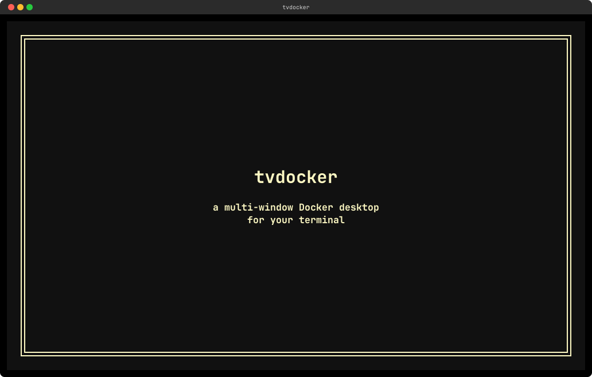

# tvdocker

Multi-window Docker TUI built on Turbo Vision (via [tvision-rs](https://github.com/oetiker/tvision-rs)): overlapping resource windows, logs side by side, and an embedded shell — the TUI never suspends. A rebuilt [oh-my-docker](https://github.com/supertorpe/oh-my-docker) on a true multi-window desktop.

The full feature tour — every window, dialog and live call, recorded from
[`demo/tvdocker-demo.toml`](./demo/tvdocker-demo.toml) with
[ansidrama](https://github.com/oetiker/ansidrama):



## Build & test

Everything runs in the pinned container — no host toolchain required:

```sh

./dcargo  test  --all-targets

./dcargo  clippy  --all-targets  --  -D  warnings

./dcargo  fmt  --  --check

./dcargo  run  # build + run the TUI

```  

## Features

- **Multi-window desktop** — open Containers, Images, Networks, Volumes, Events and Statistics as overlapping windows, each independently moved, zoomed, tiled or cascaded; opening an item already on screen focuses it instead of duplicating it
- **Never suspends** — the shell and log views run *inside* the desktop, so the TUI keeps running while you work in a container (no terminal hand-off)
- **Container list** — running/exited containers with fuzzy search and an optional initial filter via the CLI argument
- **Container details** — the parsed inspect payload in scrollable sections (name, image, command, env, mounts, networks, ports, labels, …)
- **Live logs** — per-container streaming with follow/pause (`F7`), search, scrolling and export; one Logs window per container
- **Embedded shell** — `docker exec` into a live PTY with configurable shell, user and working directory per container, and scrollback; the config is persisted to `tvdocker.toml`
- **File explorer** — host ↔ container and host ↔ volume, two panes: navigate, filter, copy, rename, delete and create files/directories; a read-only Image Explorer browses an image's filesystem
- **Image layers** — `Ctrl+L` on an image (or **Layers…** in its context menu) opens the layer explorer: the layer list beside a colour-coded change tree (Added / Removed / Modified), with an efficiency score, the potential wasted space and the inefficient paths; it streams `docker save` under the hood and never starts a container
- **Image management** — `REPOSITORY:TAG` and `SIZE`, remove, prune/dangling cleanup, and Run… (`F2`) through a validated run form
- **Networks & volumes** — names, drivers, sizes and container counts; delete with confirmation; open a volume directly in the Explorer
- **Live statistics** — `docker stats` (CPU %, memory, net, block I/O, PIDs) per container, sortable by column; each row carries the container menu (Details, Logs, Shell, Explorer, Image, Diagnose…, Stop, Delete)
- **Docker events** — a real-time, filtered event stream, newest first
- **AI diagnostics** — right-click a container → **Diagnose…** compiles recent logs, exit code, stats and config into a local or cloud LLM for root-cause analysis and a repair playbook
- **Context menus** — right-click a row (or press `Shift+F10`) for its actions (Details, Logs, Shell, Explorer, Diagnose…, Start/Stop, Delete)
- **Multi-select** — `Ctrl+A` selects the filtered rows for batch actions
- **Themes** — Options ▸ **Themes…** picks a palette; Options ▸ **Edit colors…** edits and saves your own; the selection persists in `tvdocker.toml`
- **Settings** — Options ▸ **Settings…** edits `tvdocker.toml` in-app (`F2` saves and live-reloads), including keybindings
- **Self-update** — Help ▸ **Check for updates…** queries the GitHub releases and can download and install the matching asset; an optional startup check only posts a status-line notice
- **Keyboard-first** — every action is reachable from the keyboard; the status line shows the focused window's contextual shortcuts and hides under `F10`; mouse scrolling and right-click are supported
- **Fast & resilient** — async polling keeps the UI non-blocking, logs and events use bounded ring buffers, and Docker reconnection is reported in the status line instead of crashing when the daemon is down
- **CLI** — `--help`/`-h`, `--version`/`-V`, and an optional `<search_text>` that pre-fills the Containers filter

## Windows

 Six resource windows come from the six-item **Docker** menu (`Alt+D`); the rest follow from a row's action or the menu:
  
| Trigger | Key | Window |
|---|---|---|
| Docker → Containers | `C` | running/exited containers |
| Docker → Images | `I` | REPOSITORY:TAG, SIZE |
| Docker → Networks | `N` | name, driver, CONTAINERS |
| Docker → Volumes | `V` | name, driver, SIZE |
| Docker → Events | `E` | live stream, TIME/TYPE/ACTION/ID, newest first |
| Docker → Statistics | `S` | CPU %, mem, net, block, pids per container |
| on a row | `Enter` | **Details** — parsed inspect payload, one section set |
| on a row | `F2` | **Logs ×N** — per-container stream, follow/search/export |
| on a row | `F4` | **Shell ×N** — config dialog, then a live PTY |
| on a container | `Ctrl+E` | **Explorer ×N** — host ↔ container files |
| on a volume | `Enter` | **Explorer ×N** — host ↔ volume files |
| on an image | `Ctrl+E` | **Image Explorer** — the image's filesystem, read-only |
| on an image | `Ctrl+L` | **Layers ×N** — the layer list with the colour-coded change tree, efficiency score and potential wasted space; also **Layers…** in the context menu |
| on an image | `F2` | **Run…** — the validated run form |
| on a row | `Shift+F10` | context menu (mouse-free right-click): Explorer, Details, Logs, Shell, **Diagnose…**, Start/Stop, Delete (container rows add **Image** — jumps to the Images window with the container's image under the cursor) |
| Options menu | `Alt+O` | **Settings** — the TOML editor (`F2` saves + live-reloads) |  

Right-click a row — or press `Shift+F10` on it — for the **context menu** (Details/Logs/Shell, Start/Stop, Delete, Diagnose…, Explorer; container rows also **Image**, which opens the Images window with that container's image selected). The **Containers** and **Statistics** tables carry that menu — a stats row acts on the container it measures; `Del` deletes with confirmation; `Ctrl+O` opens the **column picker** (runtime-only — reopening resets it).

Opening an item already on screen focuses it instead of duplicating it, windows cascade (+2/+1) and shrink to fit, and each keeps its own filter (`Esc` clears selection → filter → close). `Ctrl+A` selects the filtered rows; the status line shows the focused window's contextual shortcuts and hides them under `F10`.

**Layers** (one window per image) lists the image's layers — compare marker, size, history command — beside the selected layer's changes as a colour-coded file tree (`+` Added, `-` Removed, `~` Modified, blank Unmodified); the top line shows the total size, the efficiency score and the potential wasted space, and the bottom strip lists the inefficient paths (how many layers touched them, and the wasted bytes). `Space`/`+` and `-` expand and collapse directories, `*` expands all, `Ctrl+T` toggles between comparing the selected layer and comparing the whole image against its base layer, `A`/`R`/`M`/`U` show/hide Added/Removed/Modified/Unmodified rows; in this window, `Ctrl+O` steps the sort column and `/` focuses the pane's filter bar. The analysis streams the image's `docker save` and never starts a container. The layer explorer itself — the two compare modes, the colour-coded change tree, the collapse/filter keys and the efficiency scoring — is borrowed from [dive](https://github.com/wagoodman/dive).

The **Help** menu also carries **Check for updates…** — a GitHub release lookup against this repository (`src/domain/update.rs`). When the release has an asset for your platform, the dialog offers to download and install it: the archive is fetched, unpacked, and the running binary is replaced on disk — restart tvdocker to apply. Without a matching asset the dialog points at the release page instead. The optional startup check (`check_updates = true`) only latches a status-line notice; it never installs.

## Releasing

Push a version tag and the `release` workflow does the rest:

```sh
git  tag  v0.1.0 && git  push  origin  v0.1.0
```
1.  **`test`** gates the build — the same pinned-container `fmt + clippy + doc + test` run as `ci.yml`, so a release never ships from a tree CI would have rejected.

2.  **`build-platforms`** (a reusable workflow) cross-builds ten targets:

linux `x86_64`/`aarch64`/`armv7`/`i686` (gnu) and `x86_64`/`aarch64` (musl), macOS `x86_64` + `aarch64` (plus a `lipo` universal binary), and Windows `x86_64`/`i686`. Every build uses `--locked`, so the artifacts come from the committed `Cargo.lock`.

3.  **`checksums`** writes `SHA256SUMS.txt`, then **`create-release`** makes a **draft** release and uploads the archives.

The assets are named `tvdocker_<version>_<target-triple>.<ext>` (`.tar.gz` everywhere except `.zip` for Windows) — the layout `src/domain/update.rs` looks for, so **Check for updates…** finds, downloads, and installs them. The workflow mirrors oh-my-docker's release mechanism (`.github/workflows/release.yml` there) so both projects ship the same platform set.

Re-run it manually from a `v*` tag (Actions → Release → Run workflow); the tag name becomes the release name *and* the version in the asset names.

## CLI

```sh
tvdocker [--help|-h] [--version|-V] [<search_text>]
```
The positional argument pre-fills the Containers window filter.
