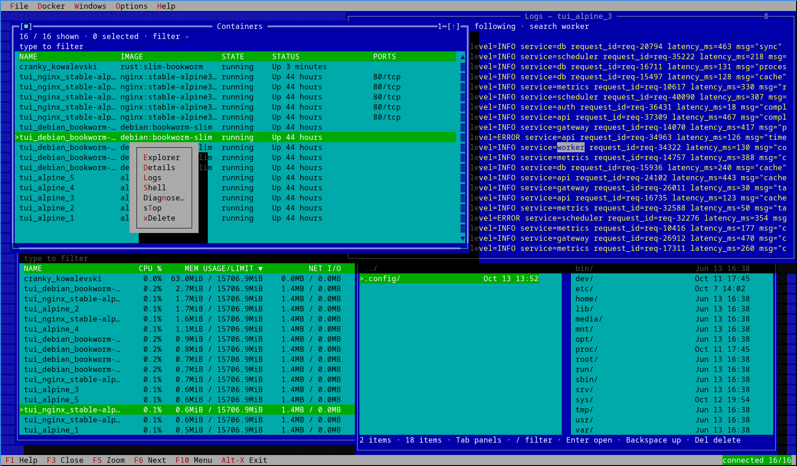

# tvdocker

Multi-window Docker TUI built on Turbo Vision (via [tvision-rs](https://github.com/oetiker/tvision-rs)): overlapping resource windows, logs side by side, and an embedded shell — the TUI never suspends. A rebuilt [oh-my-docker](https://github.com/supertorpe/oh-my-docker) on a true multi-window desktop.



## Build & test

Everything runs in the pinned container — no host toolchain required:

```sh

./dcargo  test  --all-targets

./dcargo  clippy  --all-targets  --  -D  warnings

./dcargo  fmt  --  --check

./dcargo  run  # build + run the TUI

```  

## Windows

 Six resource windows come from the six-item **Docker** menu (`Alt+D`); the rest follow from a row's action or the menu:
  
| Trigger | Key | Window |
|---|---|---|
| Docker → Containers | `C` | running/exited containers |
| Docker → Images | `I` | REPOSITORY:TAG, SIZE |
| Docker → Networks | `N` | name, driver, CONTAINERS |
| Docker → Volumes | `V` | name, driver, SIZE |
| Docker → Events | `E` | live stream, TIME/TYPE/ACTION/ID, newest first |
| Docker → Statistics | `S` | CPU %, mem, net, block, pids per container |
| on a row | `Enter` | **Details** — parsed inspect payload, one section set |
| on a row | `F2` | **Logs ×N** — per-container stream, follow/search/export |
| on a row | `F4` | **Shell ×N** — config dialog, then a live PTY |
| on a container | `Ctrl+E` | **Explorer ×N** — host ↔ container files |
| on a volume | `Enter` | **Explorer ×N** — host ↔ volume files |
| on an image | `Ctrl+E` | **Image Explorer** — the image's filesystem, read-only |
| on an image | `F2` | **Run…** — the validated run form |
| right-click a container | — | context menu: Explorer, Details, Logs, Shell, **Diagnose…**, Start/Stop, Delete |
| Options menu | `Alt+O` | **Settings** — the TOML editor (`F2` saves + live-reloads) |  

Right-click a row for the **context menu** (Details/Logs/Shell, Start/Stop, Delete, Diagnose…, Explorer); `Del` deletes with confirmation; `Ctrl+O` opens the **column picker** (runtime-only — reopening resets it).

Opening an item already on screen focuses it instead of duplicating it, windows cascade (+2/+1) and shrink to fit, and each keeps its own filter (`Esc` clears selection → filter → close). `Ctrl+A` selects the filtered rows; the status line shows the focused window's contextual shortcuts and hides them under `F10`.

The **File** menu also carries **Check for updates…** — a GitHub release lookup whose wiring is **frozen** for now (it still points at a placeholder repository; see `src/domain/update.rs`).

## Releasing

Push a version tag and the `release` workflow does the rest:

```sh
git  tag  v0.1.0 && git  push  origin  v0.1.0
```
1.  **`test`** gates the build — the same pinned-container `fmt + clippy + doc + test` run as `ci.yml`, so a release never ships from a tree CI would have rejected.

2.  **`build-platforms`** (a reusable workflow) cross-builds ten targets:

linux `x86_64`/`aarch64`/`armv7`/`i686` (gnu) and `x86_64`/`aarch64` (musl), macOS `x86_64` + `aarch64` (plus a `lipo` universal binary), and Windows `x86_64`/`i686`. Every build uses `--locked`, so the artifacts come from the committed `Cargo.lock`.

3.  **`checksums`** writes `SHA256SUMS.txt`, then **`create-release`** makes a **draft** release and uploads the archives.

The assets are named `tvdocker_<version>_<target-triple>.<ext>` (`.tar.gz` everywhere except `.zip` for Windows) — the layout `src/domain/update.rs` already looks for, so the update check will find them once its repository is configured. The workflow mirrors oh-my-docker's release mechanism (`.github/workflows/release.yml` there) so both projects ship the same platform set.

Re-run it manually from a `v*` tag (Actions → Release → Run workflow); the tag name becomes the release name *and* the version in the asset names.

## CLI

```sh
tvdocker [--help|-h] [--version|-V] [<search_text>]
```
The positional argument pre-fills the Containers window filter.
